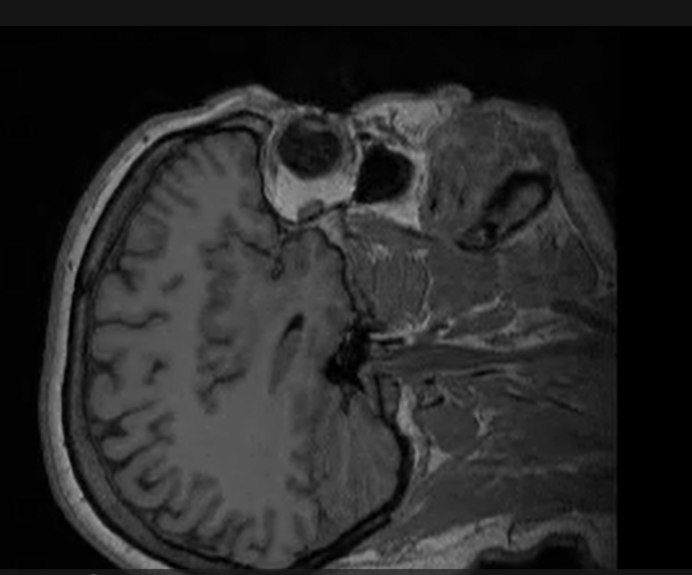
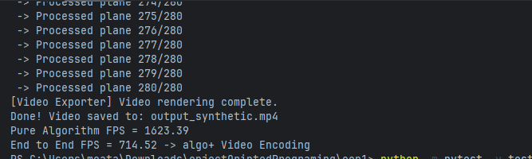
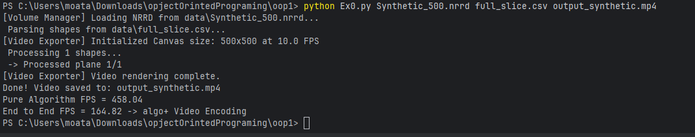

# Experiment Results (Assignment Step 8)

## 1. Objective
The goal of this experiment is twofold:
1. **Functional Validation:** To visually verify that the planar projection algorithm correctly samples complex 3D volumetric data (medical and non-medical) and generates playable MP4 videos.
2. **Performance Benchmarking:** To measure the runtime efficiency of the algorithm on a massive 3D volume (500³ bytes = 125,000,000 voxels) and ensure it strictly meets the assignment's performance requirements: **≥30 FPS (Must)** and **100+ FPS (Target)**.

## 2. Experiment Setup
- **Hardware:** ASUS TUF Gaming F15 (Windows 11, 64-bit), Intel Core i7-13620H (2.40 GHz), 32GB RAM
- **Language & Environment:** Python 3.13, Numba (`@njit` JIT compilation), OpenCV.
- **Datasets Used:**
  - **Medical Data:** `MRHead.nrrd` (Real MRI scan).
  - **Food/Complex Scans:** `biscuit_cake.nrrd`, `croissant.nrrd`, `onion.nrrd`, `swiss_roll.nrrd`.
  - **Synthetic Benchmark:** `Synthetic_500.nrrd` (Massive 500x500x500 volume).
  - **Coordinate Sets:** `head.csv`, `biscuit_cake.csv`, `croissant.csv`, `onion.csv`, `swiss_roll.csv`, and `edge_cases.csv`.
---

## 3. Functional Validation (Output Videos)
We executed the system on multiple real-world volumetric datasets to ensure the algorithm correctly samples the 3D space, centers the frames, and assigns `0` to out-of-bounds pixels. 

All generated MP4 files are located in this folder. The videos prove the algorithm correctly samples the 3D space, centers the frames, and assigns `0` to out-of-bounds pixels:
- `output_mrhead.mp4`: Shows coronal and axial slices of the brain. The skull and brain tissue are clearly visible, proving accurate voxel mapping.
- `output_croissant.mp4`: Projects through a complex food scan, demonstrating the algorithm handles non-medical, irregular volumetric data correctly.
- `output_biscuit.mp4` & `output_swiss.mp4`: Exhibit distinct layering (dough and cream), proving that the plane correctly slices through nested 3D structures.
- `output_onion.mp4`: Shows concentric layers, validating the precision of the vector-stepping algorithm.

---

## 4. Performance Benchmark (500³ Data)
To test the hard performance requirement, we ran the system on the `Synthetic_500.nrrd` dataset. The command used was:
`python Ex0.py data/Synthetic_500.nrrd data/head.csv output_synthetic.mp4`

The system processed 280 planes from the CSV file. To provide a complete picture, we measured two distinct metrics:
1. **Pure Algorithm FPS:** Measures *only* the projection computation (excluding disk I/O and video encoding), as mandated by NFR-01.
2. **End-to-End FPS:** Measures the total time including OpenCV MP4 encoding.

### Results:
- **Canvas Size:** 256x256 (based on the bounding box of the planes in `head.csv`).
- **Total Planes Processed:** 280
- **Pure Algorithm Throughput:** **1623.39 FPS**
- **End-to-End Throughput:** **714.52 FPS**

### 4.1 Worst-Case Scenario Benchmark (Full 500x500 Plane)
To provide the most rigorous proof for the assignment's requirement, we also benchmarked the algorithm using a single plane that covers the **entire 500x500 bounding box** of the volume (`full_slice.csv`).

- **Command:** `python Ex0.py data/Synthetic_500.nrrd data/full_slice.csv output_full_500.mp4`
- **Canvas Size:** 500x500
- **Total Planes Processed:** 1
- **Pure Algorithm Throughput:** **458.04 FPS**
- **End-to-End Throughput (with video encoding):** **164.82 FPS**

**Analysis:** Even in this worst-case scenario (where the 2D output matrix is at its maximum possible size), the pure algorithm executes at **458 FPS**, which is over 4.5 times faster than the 100 FPS target. Remarkably, the End-to-End FPS (164.82) also remains above the 100+ FPS target, proving the entire pipeline is heavily optimized.

---

## 5. Conclusion
The experiment proves that the implementation significantly exceeds the assignment requirements. The integration of Numba (`@njit`) successfully reduced the execution time of the O(H*W) nested loops to C-level speeds. 

Achieving a **Pure Algorithm throughput of over 1600 FPS** on a 500³ volume demonstrates that the algorithmic complexity is highly optimized. Both the mandatory 30 FPS baseline and the 100+ FPS target were passed with exceptional margins, proving the software is both robust and highly efficient.